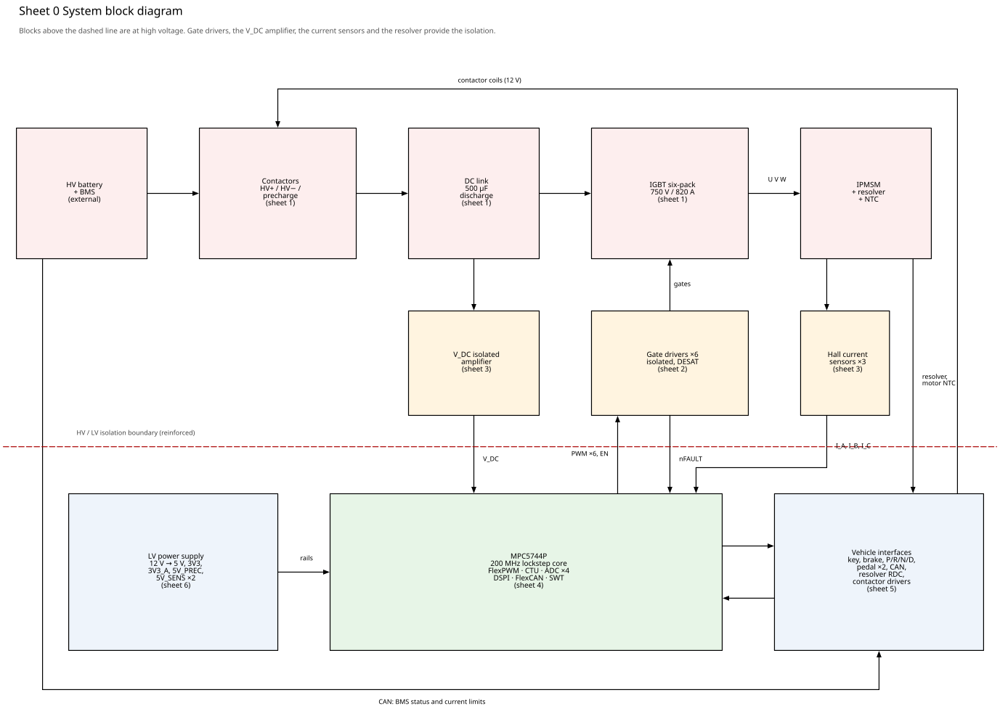
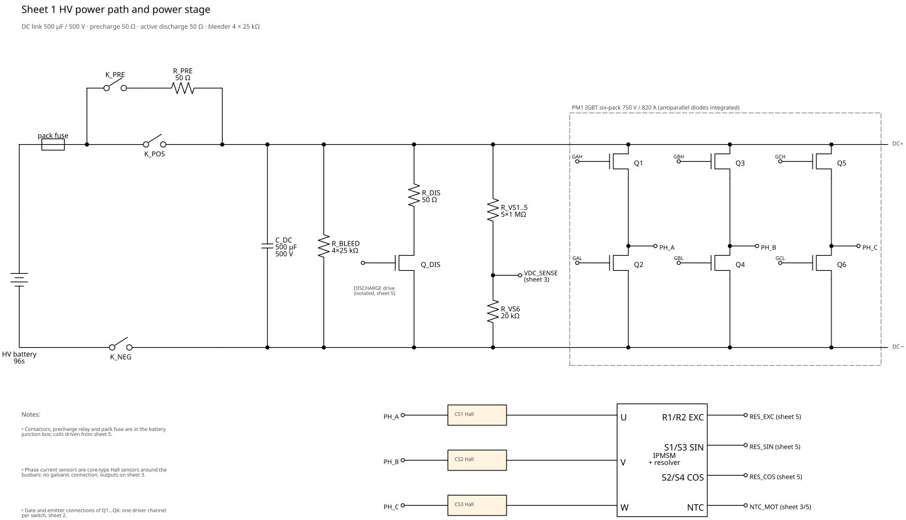
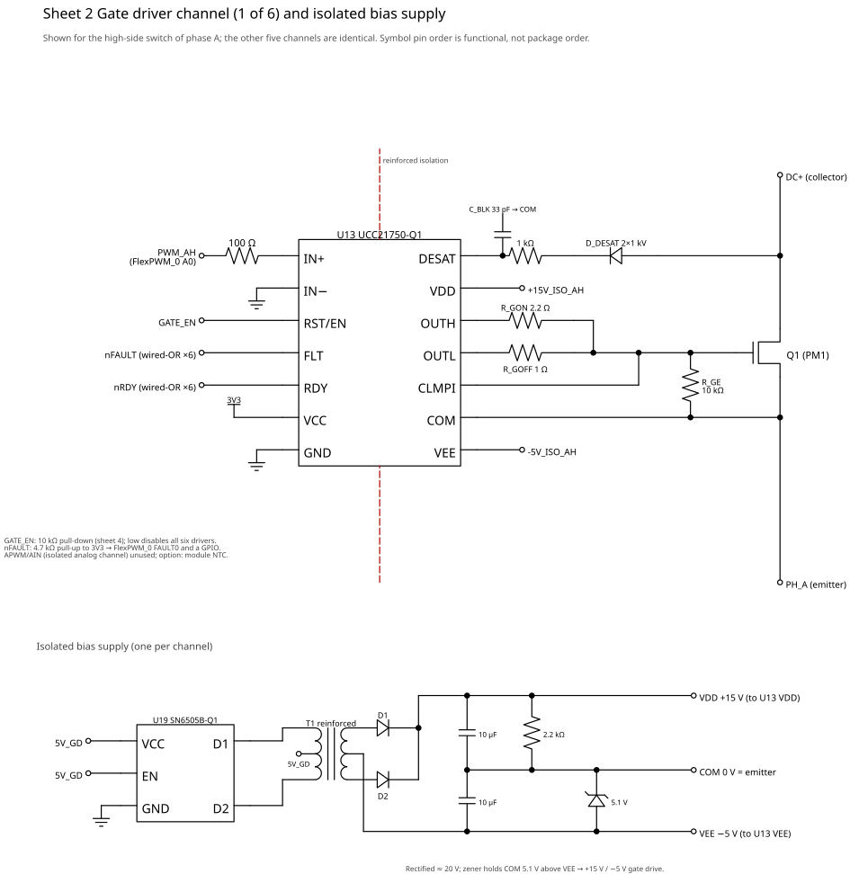
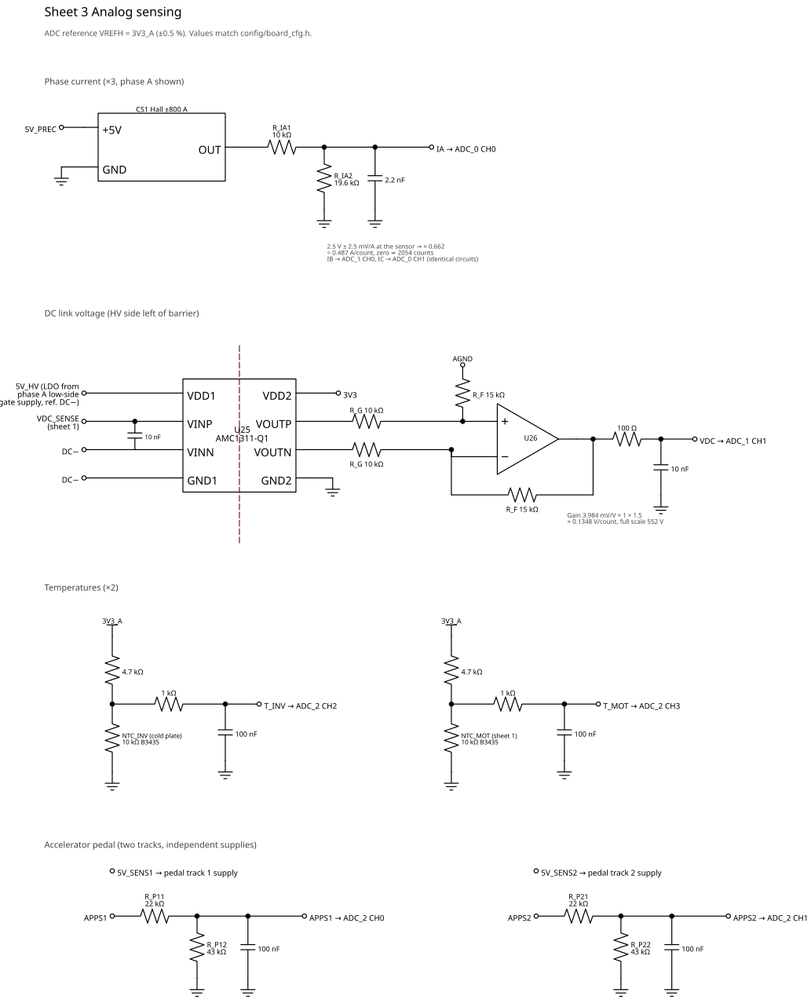
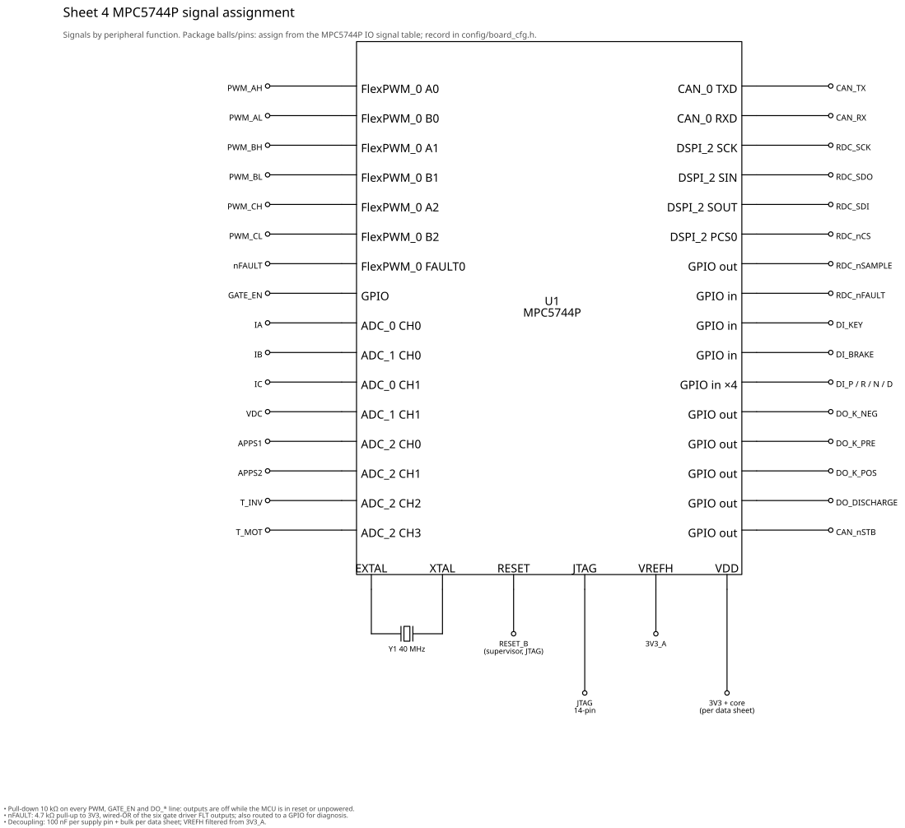
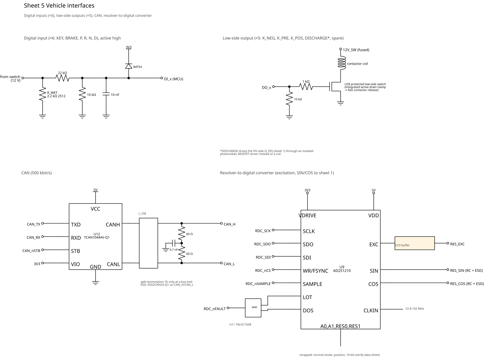
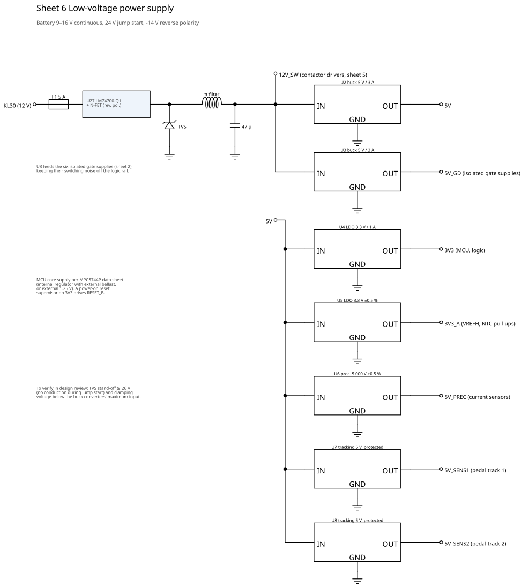

# Hardware Design and Schematics

| Item | Value |
|---|---|
| Document | HDD, concept hardware design |
| Status | **Concept**, not a manufacturing design |
| Implements | [05 Hardware Requirements](05_hardware_requirements.md) |
| Sources | `tools/hw_design.py` (component values), `tools/draw_schematics.py` (drawings), `config/board_cfg.h` (firmware side of the same values) |

## 1. What this is, and what it is not

These schematics define the circuit topology, the component values that
matter for function and safety, and the candidate parts. They're drawn from
code: the values come from the same data the design analysis
([08](08_hardware_verification_results.md)) and the firmware use, so they
can't silently disagree. `make hw-report` fails if they do.

They are **not** ready for PCB layout or manufacturing:

* Package pin numbers aren't assigned. Signals are named by function
  (e.g. "FlexPWM_0 A0"). Pin assignment needs the MPC5744P IO signal table.
* Several parts are candidates whose data sheet values haven't been
  confirmed (marked *verify* in the [BOM](hw/bom.md)). Analyses that depend
  on them are reported as PASS\* rather than PASS.
* Decoupling, connector pinouts, test points, protection on every connector
  pin, and layout constraints (creepage, clearance, current loops) still
  have to be specified.

Regenerate the drawings with `make schematics` (needs `pip install schemdraw==0.19`).

## 2. Sheets

### Sheet 0: System block diagram

### Sheet 1: HV power path and power stage

* Contactors, precharge relay and fuse are in the battery junction box; this
  board drives their coils (sheet 5).
* **Precharge** 50 Ω: 95 % of 403 V in 87 ms worst case, 8.5 A peak,
  45 J per precharge. **Active discharge** 50 Ω through Q_DIS: 430 V → 60 V in
  54 ms. **Bleeder** 4 × 25 kΩ: < 60 V in 108 s with no supply at all.
  Calculations: HVC-AN-008…010.
* DC link film capacitor rated **500 V**. The analysis rejected 450 V: it
  leaves no margin above the 430 V overvoltage trip.

### Sheet 2: Gate driver channel (×6)

* UCC21750-Q1 class driver: reinforced isolation, DESAT detection with soft
  turn-off, active Miller clamp, open-drain FLT.
* All six FLT outputs form the wired-OR **nFAULT** line into FlexPWM_0
  FAULT0. The PWM outputs are switched off by hardware without software
  involvement (SVC-HW-003, HVC-BN-009).

All figures quoted on this page come from the generated analysis report
([08](08_hardware_verification_results.md)), which takes precedence.
* Each channel has its own transformer-isolated bias supply: rectified
  ≈ 20 V, split by a 5.1 V zener into +15 V / −5 V around the emitter.

### Sheet 3: Analog sensing

* **Phase current**: Hall sensor (2.5 V ± 2.5 mV/A) → 10 k / 19.6 k divider →
  2.2 nF. 0.487 A/count, −1000…+993 A measurable, 2.6° lag at 500 Hz.
  The sensors run from a **precision 5 V (±0.5 %)**. With a standard ±2 %
  regulator, the ratiometric zero point could move by 23 A, more than the
  15 A start-up calibration limit. HVC-AN-003 shows the comparison.
* **DC link voltage**: 5 × 1 MΩ / 20 kΩ string → AMC1311-Q1 isolated
  amplifier → difference amplifier (gain 1.5). 0.135 V/count, full scale 552 V.
  The isolated amplifier's high side is powered from the phase A low-side
  gate supply, which is referenced to DC−.
* **Temperatures**: 10 kΩ NTC with a **4.7 kΩ** pull-up to the ADC reference
  (ratiometric). The original 10 kΩ pull-up gave only 0.57 °C/count at the
  165 °C motor trip; 3.3 kΩ would make −40 °C read as an open sensor.
* **Pedal**: 22 k / 43 k divider + 100 nF. The first design (10 k / 19.6 k)
  would inject 1.24 mA into the clamp if the signal were shorted to the
  battery; 22 k limits it to 0.56 mA.

### Sheet 4: MPC5744P signal assignment

### Sheet 5: Vehicle interfaces

* **Switch inputs**: 2.2 kΩ wetting resistor (5 mA at 12 V) in a **2512**
  package. A 1206 resistor would exceed its rating during a 24 V jump start.
  22 k / 10 k divider: 2.5 V at 8 V input; Schottky clamp to 3.3 V.
* **Contactor drivers**: protected low-side switches with an integrated
  active drain clamp, for fast contactor release. A plain TVS across the
  coil was rejected: it conducts like a freewheel diode and slows the release.
* **Resolver**: AD2S1210 RDC; LOT and DOS combined by an AND gate into the
  single active-low fault input the firmware reads.

### Sheet 6: Low-voltage power supply

* Separate 5 V buck for the six isolated gate supplies (2.0 A at 5 V, 96 % of
  the 70 % loading limit, so little margin: confirm the module gate charge),
  keeping their switching noise and load off the logic rail.
* Dedicated supplies for the ADC reference (3V3_A), current sensors
  (5V_PREC) and each pedal track (5V_SENS1/2).

## 3. Firmware interface

| Firmware symbol | Hardware | Where checked |
|---|---|---|
| `ADC_VREF_V` = 3.3 | 3V3_A ±0.5 % (U5) on VREFH | HVC-AN-001…006 |
| `CUR_DIV_R_TOP_OHM`, `CUR_DIV_R_BOT_OHM`, `CUR_SENSOR_V_PER_A`, `CUR_SENSOR_ZERO_V` | R_IA1/R_IA2, CS1…CS3 | HVC-AN-001 |
| `VDC_DIV_R_TOP_OHM`, `VDC_DIV_R_BOT_OHM`, `VDC_ISO_GAIN`, `VDC_OPAMP_GAIN` | R_VS1…6, U25, U26 with R_F / R_G | HVC-AN-004 |
| `APPS_DIV_R_TOP_OHM`, `APPS_DIV_R_BOT_OHM` | R_Px1/R_Px2 | HVC-AN-006 |
| `NTC_PULLUP_OHM`, `NTC_R25_OHM`, `NTC_BETA` | 4.7 kΩ pull-ups, NTCs | HVC-AN-005 |
| `INV_DEADTIME_NS`, `PWM_FREQ_HZ`, `MOTC_CLK_HZ`, `CTU_SAMPLE_DELAY_NS` | power module, gate drivers | HVC-AN-013 |
| FlexCAN CTRL1 in `bsp_can.c` | Y1 crystal tolerance | HVC-AN-014 |
| `PRECHARGE_TIMEOUT_MS`, `DISCHARGE_TIMEOUT_MS`, `HV_OV_TRIP_V` | R_PRE, R_DIS, R_BLEED, C_DC | HVC-AN-008…011 |

## 4. Bill of materials

See [hw/bom.md](hw/bom.md) (generated).

## 5. Open design items

| Item | Needed |
|---|---|
| Pin assignment | MPC5744P IO signal table → package pins, then `board_cfg.h` |
| Data sheet confirmation | Every *assumed* value in `tools/hw_design.py`; rerun `make hw-report` |
| MCU core supply | Choose internal regulator + ballast or external 1.25 V per data sheet |
| Resolver | Excitation amplitude and SIN/COS input scaling for the chosen resolver's transformation ratio |
| Protection | Connector-level ESD/EMC filtering for every pin |
| Layout | Creepage/clearance for 450 V working voltage, gate loop inductance, current sensor placement |
| Safety | External watchdog / safety SBC and independent shutdown path (firmware support needed) |
